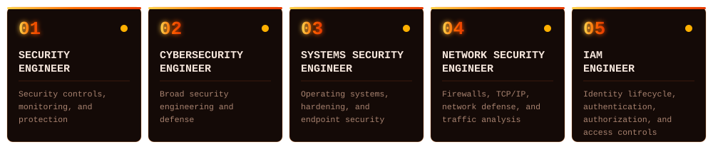
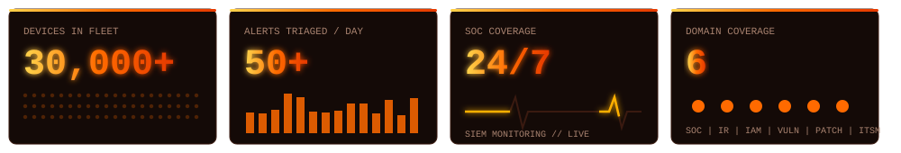
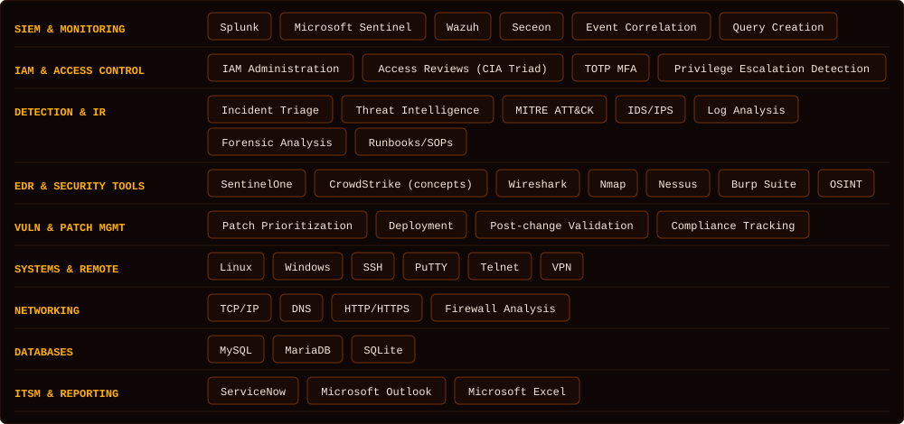
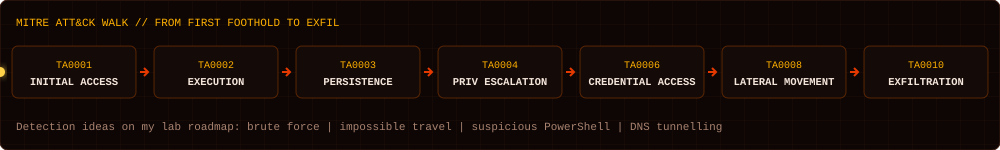

### [ TARGET ROLES ] Where I'm Heading

### [ INCIDENT SUMMARY ] Operator Profile

| FIELD | VALUE |
|---|---|
| **Operator** | Naroju Chiranjeevi (NChiranjeevi) |
| **Role** | Associate IT Support Engineer, Cybersecurity Operations |
| **Scope** | 24/7 SIEM monitoring across a 30,000+ device BFSI fleet |
| **Domains** | SOC operations, incident response, IAM and access control, vulnerability and patch management |
| **Location** | Hyderabad, Telangana, IN |
| **Status** | 🟢 Open to Security Engineer, Cybersecurity Engineer, Systems Security Engineer, Network Security Engineer and IAM Engineer roles |

### [ SOC DASHBOARD ] Operational Footprint

### [ PIPELINE ] How an Alert Gets Closed

### [ TOOLING ] Full Stack

| DOMAIN | STACK |
|---|---|
| SIEM and Monitoring | Splunk, Microsoft Sentinel, Wazuh, Seceon, Event Correlation, Query Creation |
| IAM and Access Control | IAM Administration, Access Reviews (CIA Triad), TOTP MFA, Privilege Escalation Detection |
| Detection and IR | Incident Triage, Threat Intelligence, MITRE ATT&CK, IDS/IPS, Log Analysis, Forensic Analysis, Runbooks/SOPs |
| EDR and Security Tools | SentinelOne, CrowdStrike (concepts), Wireshark, Nmap, Nessus, Burp Suite, OSINT |
| Vuln and Patch Mgmt | Patch Prioritization, Deployment, Post-change Validation, Compliance Tracking |
| Systems and Remote | Linux, Windows, SSH, PuTTY, Telnet, VPN |
| Networking | TCP/IP, DNS, HTTP/HTTPS, Firewall Analysis |
| Databases | MySQL, MariaDB, SQLite |
| ITSM and Reporting | ServiceNow, Microsoft Outlook, Microsoft Excel |

### [ SERVICE RECORD ] Experience

| PERIOD | ROLE | ORG | OPERATIONS |
|---|---|---|---|
| Nov 2025 - Present | Associate IT Support Engineer, Cybersecurity Operations | iVIS International Pvt Ltd | 24/7 SIEM monitoring, 50+ daily alert triage, IAM and TOTP MFA reviews, patch and vulnerability management on a 30,000+ device fleet, MySQL/MariaDB configuration validation |
| Sep 2025 - Nov 2025 | Monitoring L1 Trainee | iVIS International Pvt Ltd | Real-time SIEM monitoring, alert triage and escalation per SOC runbooks |
| Mar 2025 - Aug 2025 | Software Engineer Intern, Application Security | Alluxis Technologies | Secure coding and access management controls in the SDLC, Salesforce CRM data protection |

**Education:** B.Tech, Electronics and Communication Engineering, CMRIT (2020 - 2024)

### [ CREDENTIALS ] Certifications

| CREDENTIAL | ISSUER | DATE |
|---|---|---|
| Cisco Certified Ethical Hacker | Cisco Networking Academy | Jun 2026 |
| Blue Team Fundamentals (BTF) | CyberWarFare Labs | Oct 2026 |
| Google Professional Cybersecurity Certificate | Google / Coursera | Jul 2024 |
| IBM Cybersecurity Analyst Professional Certificate | IBM / Coursera | Jun 2024 |
| ISC2 Candidate Badge | ISC2 | Nov 2025 |
| Deloitte Australia Cyber Job Simulation (virtual simulation) | Forage | Jun 2025 |
| J.P. Morgan and Tata Group Cybersecurity Job Simulations (virtual simulations) | Forage | Aug 2024 |

### [ ACTIVE OPS ] Lab Roadmap

- [x] Blue Team Fundamentals (CyberWarFare Labs) completed
- [ ] CyberWarFare Labs C3SA course (in progress)
- [ ] SIEM monitoring and alert triage write-ups
- [ ] Splunk SPL detections: brute force, impossible travel, suspicious PowerShell
- [ ] Wazuh home lab with custom rules mapped to MITRE ATT&CK
- [ ] PCAP write-ups with Wireshark: C2 beaconing, DNS tunneling, phishing
- [ ] Incident report templates and vulnerability triage playbook
- [ ] Linux hardening lab (systems security)
- [ ] Firewall rule and traffic analysis lab (network security)
- [ ] IAM lab: identity lifecycle, MFA/TOTP, access reviews

### [ CASE FILES ] Featured Repositories

| REPO | SUMMARY | STACK | STATUS |
|---|---|---|---|
| [runbooks/001](runbooks/001-site-down-web-ui-port-3000.md) | Site down: device web UI not opening, restore config and restart service | Linux, SSH/PuTTY, SQLite | 🟢 Live |
| [runbooks/002](runbooks/002-site-down-mariadb-service.md) | Site down: DB service stopped, start DB, restart app, verify OSGi bundles | Raspberry Pi OS, MariaDB, OSGi | 🟢 Live |
| soc-detections | SPL and Sigma detection rules with ATT&CK mapping | Splunk, Sigma | 🟠 Planned |
| wazuh-homelab | Lab build notes, agents, custom rules | Wazuh, Linux | 🟠 Planned |
| ir-playbooks | Triage checklists and incident report templates | IR, ITSM | 🟠 Planned |

Daily notes live in [`/daily-log`](daily-log/README.md).

### [ ACTIVITY LOG ] Contribution Trace

### [ COMMS ] Open Channels

